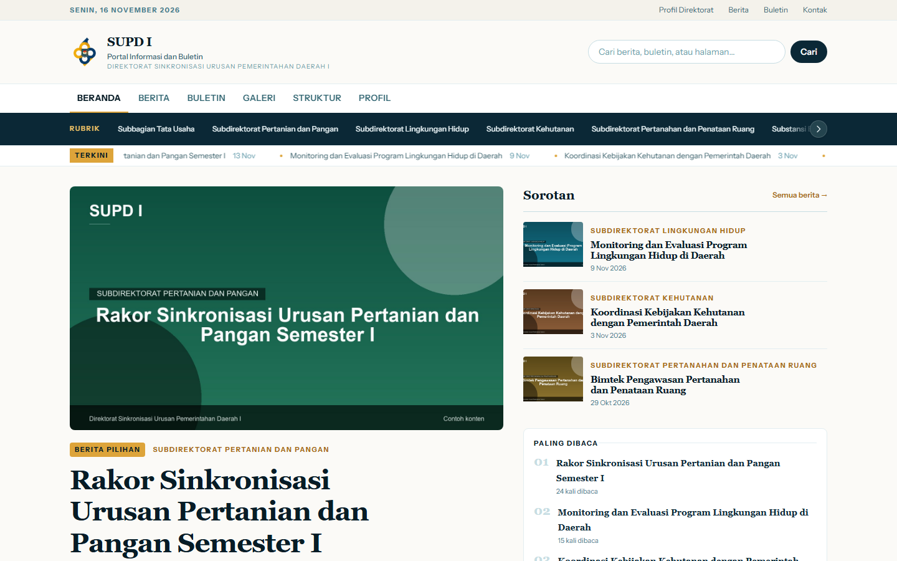
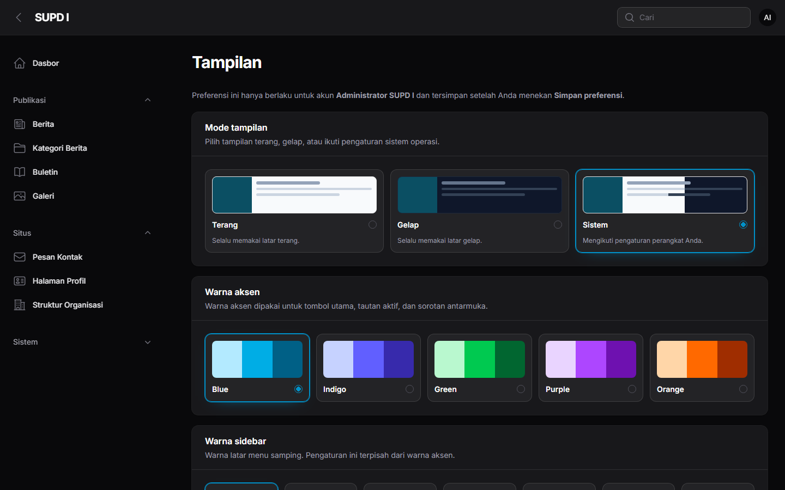
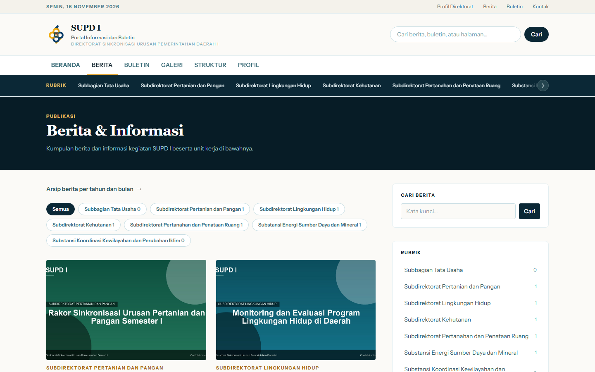
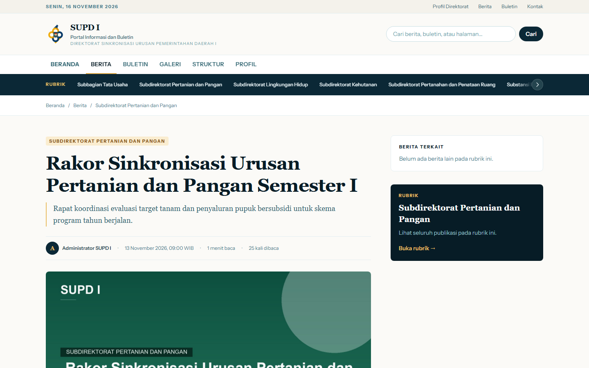
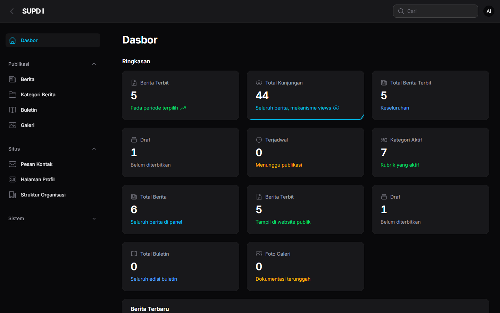
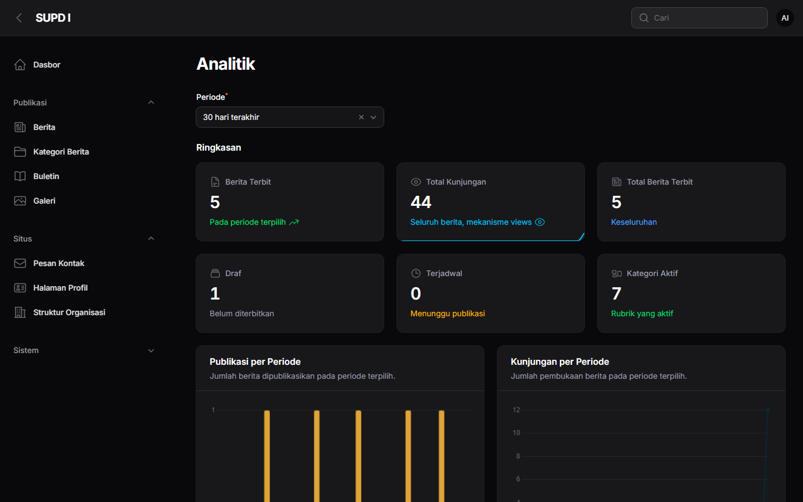
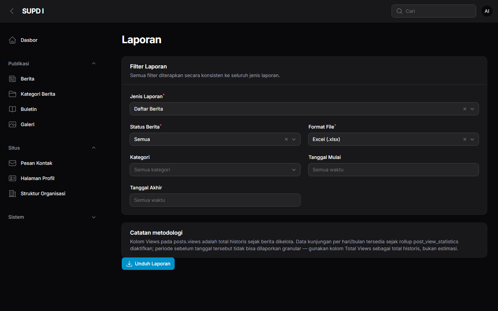
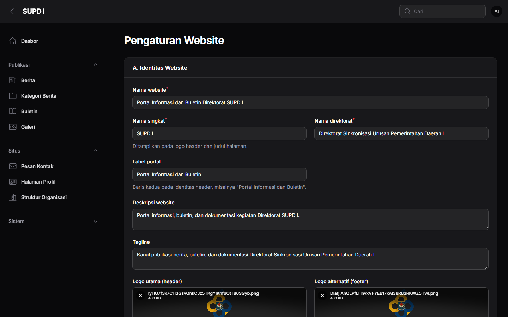

<p align="center">
  
</p>

<h1 align="center">Portal Informasi dan Buletin Direktorat SUPD I</h1>

<p align="center">
  Kanal publikasi resmi <strong>Direktorat Sinkronisasi Urusan Pemerintahan Daerah I</strong> —
  berita kegiatan, buletin, galeri, profil direktorat, dan struktur organisasi,
  dikelola melalui panel admin terpadu.
</p>

<p align="center">
  
  
  
  
  
  
  
</p>

<p align="center">
  <a href="CHANGELOG.md">Changelog</a> · <a href="CONTRIBUTING.md">Kontribusi</a> · <a href="SECURITY.md">Keamanan</a> · <a href="docs/OPERATIONS.md">Operasi</a> · <a href="LICENSE">Lisensi</a>
</p>



## Tentang

Portal ini melayani dua audiens:

- **Publik** — membaca berita dan buletin resmi Direktorat SUPD I, mencari publikasi,
  melihat galeri, struktur organisasi, profil direktorat, serta mengirim pesan kontak.
- **Internal (admin/editor)** — mengelola seluruh konten dan pengaturan situs lewat panel
  admin Filament, memantau analitik kunjungan, serta mengekspor laporan.

Seluruh antarmuka berbahasa Indonesia, zona waktu `Asia/Jakarta`, dan mengikuti identitas
visual resmi SUPD I (hijau tua, emas, dan putih).

## Fitur

### Situs publik

| Fitur | Keterangan |
|-------|-----------|
| Beranda | Rubrik terpilih, ticker “Terkini” dengan prioritas breaking news, sorotan terbaru, dan berita pilihan |
| Berita & publikasi | Daftar berita per rubrik/satuan kerja, detail artikel, prev/next, terkait, estimasi waktu baca, dan hitung kunjungan |
| Arsip | Indeks berita per tahun dan bulan |
| Kategori (rubrik) | Halaman rubrik sesuai bidang kerja direktorat |
| Buletin | Daftar edisi buletin, lihat di browser, unduh PDF |
| Galeri | Dokumentasi foto kegiatan |
| Pencarian | Pencarian global berita, buletin, dan halaman (dengan throttle) |
| Halaman profil | “Tentang SUPD I” yang dapat diedit dari panel |
| Struktur organisasi | Bagan unit kerja dan pemangku jabatan |
| Kontak | Formulir pesan masuk dengan notifikasi email ke administrator |
| RSS & sitemap | `rss.xml`, `feed`, `sitemap.xml`, `robots.txt` untuk crawler |
| Caching halaman publik | Cache HTML penuh untuk pengunjung anonim (dapat diatur) |

### Panel admin (`/admin`)

Panel dikelompokkan menjadi tiga grup navigasi:

- **Publikasi**
  - *Berita* — CRUD lengkap: draf/terbit, terjadwal, preview, berita pilihan (`is_featured`), breaking news (`is_breaking`) yang tampil paling depan di ticker “Terkini”, rubrik, unggahan gambar dengan validasi integritas, workflow publikasi tercatat di audit log
  - *Kategori Berita* — kelola rubrik/satuan kerja
  - *Buletin* — unggah edisi buletin (PDF) + deskripsi
  - *Galeri* — manajemen foto dokumentasi
- **Situs**
  - *Pesan Kontak* — kotak masuk pesan pengunjung, lihat detail, tandai status
  - *Halaman Profil* — editor konten “Tentang SUPD I”
  - *Struktur Organisasi* — pohon unit kerja dan monogram
- **Sistem**
  - *Pengguna* — kelola akun **Administrator** dan **Editor**
  - *Pengaturan Website* — identitas situs (nama, direktorat, tagline, logo header/footer, kontak, media sosial) — hanya Administrator
  - *Tampilan* — preferensi tampilan personal per pengguna (lihat di bawah)
  - *Analitik* — ringkasan publikasi dan kunjungan per periode dengan grafik
  - *Laporan* — ekspor ke **Excel (.xlsx)** dan **CSV**: daftar berita, statistik publikasi, statistik kunjungan, berita terpopuler, distribusi per kategori; ekspor CSV aman dari formula injection
  - *Audit Log* — catatan aktivitas sistem (login, CRUD konten, ekspor) dengan before/after, retensi otomatis (`audit:prune`)
  - *Dasbor* — ringkasan portal: berita terbit, draf, terjadwal, total kunjungan, kategori aktif, buletin & galeri

Akses halaman *Sistem* (Pengaturan Website, Analitik, Laporan, Pengguna, Audit Log) dibatasi
untuk peran **Administrator**; peran **Editor** fokus pada pengelolaan konten.

### Tampilan personal (Appearance)

Setiap pengguna panel dapat menyesuaikan tampilan **untuk akunnya sendiri** di
**Admin → Tampilan** (`/admin/tampilan`), tersimpan permanen setelah logout/login, dan
diberlakukan pada seluruh halaman admin tanpa kedipan tema (dirender server-side sebelum
first paint):

- **Mode tampilan** — Terang / Gelap / Ikuti sistem
- **Warna aksen** — Blue, Indigo, Green, Purple, Orange
- **Kepadatan (density)** — Nyaman / Ringkas
- **Bilah samping** — Diperluas / Diciutkan di desktop
- **Warna sidebar** — **independen dari warna aksen** (Slate, Teal, Blue, Indigo, Green, Purple, Orange, atau Bawaan), otomatis menyesuaikan kontras teks/ikon di mode terang maupun gelap, termasuk header drawer di mobile

Semua nilai preferensi divalidasi dengan whitelist di server; nilai rusak atau manipulatif
jatuh kembali ke bawaan yang aman.



### Otomasi & terjadwal

| Perintah | Jadwal | Fungsi |
|----------|--------|--------|
| `posts:publish-scheduled` | setiap menit | Mencatat jejak audit penerbitan otomatis untuk berita terjadwal yang jam tayangnya baru terlampaui (publikasi sendiri ditangani scope `published()`) |
| `audit:prune` | harian | Menghapus audit log lama sesuai retensi |
| `reports:email-monthly` | bulanan (tgl 1, 07:00 WIB) | Mengirim laporan bulanan via email (xlsx) |
| `backup:database` | harian (02:30 WIB) | Backup database (SQLite copy / mysqldump / pg_dump, di-gzip) + rotasi retensi (`--keep=14`) |

## Cuplikan layar

<table>
  <tr>
    <td align="center"><br><sub>Daftar berita publik</sub></td>
    <td align="center"><br><sub>Detail artikel</sub></td>
  </tr>
  <tr>
    <td align="center"><br><sub>Dasbor admin</sub></td>
    <td align="center"><br><sub>Analitik publikasi &amp; kunjungan</sub></td>
  </tr>
  <tr>
    <td align="center"><br><sub>Ekspor laporan (xlsx/csv)</sub></td>
    <td align="center"><br><sub>Pengaturan Website (Administrator)</sub></td>
  </tr>
</table>

Gambar lain tersedia di folder [`docs/images`](docs/images).

## Tech stack

- **Framework**: Laravel 13 (PHP ^8.3)
- **Panel admin**: Filament 5 (Livewire 4)
- **Frontend publik**: Blade + Tailwind CSS 4 (Vite 8)
- **Database**: SQLite (bawaan) / MySQL / PostgreSQL
- **Queue & cache**: database driver (bawaan); Redis opsional
- **Pengujian**: PHPUnit
- **Format & kualitas**: Laravel Pint

## Persyaratan

- PHP 8.3+ dengan ekstensi umum Laravel (`mbstring`, `gd`, `sqlite3`/`pdo_mysql`, `zip`, `intl`)
- Composer 2
- Node.js 20+ dan npm

## Instalasi

```bash
git clone <url-repositori> portal-supd1
cd portal-supd1
composer setup
```

Perintah `composer setup` menjalankan: `composer install`, menyalin `.env.example` ke `.env`,
`key:generate`, `migrate`, `npm install`, dan `npm run build`.

Langkah tambahan yang perlu dilakukan sekali:

```bash
# Tautan publik untuk unggahan (storage/app/public → public/storage)
php artisan storage:link

# Isi data awal (opsional — rubrik, halaman profil, struktur organisasi, sampel berita)
php artisan db:seed
```

Seeder membuat akun Administrator awal dari variabel lingkungan:

| Variabel         | Default                | Keterangan                          |
|------------------|------------------------|-------------------------------------|
| `ADMIN_NAME`     | `Administrator SUPD I` | Nama tampilan Administrator          |
| `ADMIN_EMAIL`    | `admin@supd1.local`    | Email login panel admin             |
| `ADMIN_PASSWORD` | `password`             | **Ganti untuk lingkungan produksi** |

> Jangan pernah menyemai produksi dengan kata sandi default. Atur `ADMIN_PASSWORD` di `.env`
> sebelum menjalankan `db:seed`.

Secara bawaan aplikasi memakai SQLite; untuk MySQL/PostgreSQL, sesuaikan `.env`:

```dotenv
DB_CONNECTION=mysql
DB_HOST=127.0.0.1
DB_PORT=3306
DB_DATABASE=portal_supd1
DB_USERNAME=portal
DB_PASSWORD=secret
```

## Menjalankan aplikasi

```bash
# Mode pengembangan (server + queue + vite)
composer dev

# Atau manual
php artisan serve
npm run dev
```

- Situs publik: `http://localhost:8000`
- Panel admin: `http://localhost:8000/admin`
- Login: `ADMIN_EMAIL` / `ADMIN_PASSWORD` dari `.env`

## Pengujian

```bash
php artisan test          # seluruh suite
composer test             # config:clear + test
php artisan test --filter=AdminAppearanceTest
```

## Kualitas kode & CI

```bash
vendor/bin/pint           # format seluruh perubahan
vendor/bin/pint --dirty   # hanya berkas yang berubah (butuh Git)
```

Setiap push ke `main` dan pull request dijalankan otomatis oleh GitHub Actions
(`.github/workflows/ci.yml`): build, Pint, dan seluruh suite pengujian.

## Operasional & backup

Untuk deployment produksi, penjadwalan, queue worker, backup harian database,
rotasi log, monitoring (`GET /up`), dan troubleshooting, lihat
[docs/OPERATIONS.md](docs/OPERATIONS.md).

Backup juga bisa dijalankan manual:

```bash
php artisan backup:database              # backup + rotasi retensi 14 hari
php artisan backup:database --keep=30    # ubah masa retensi
```

## Variabel lingkungan penting

| Variabel | Default | Fungsi |
|----------|---------|--------|
| `APP_NAME` | `Portal Informasi SUPD I` | Nama aplikasi |
| `APP_URL` | `http://localhost:8000` | Basis URL untuk route & sitemap |
| `APP_TIMEZONE` | `Asia/Jakarta` | Zona waktu tampilan |
| `APP_LOCALE` | `id` | Bahasa antarmuka |
| `PUBLIC_PAGE_CACHE` | `true` | Aktif/nonaktifkan cache halaman publik anonim |
| `PUBLIC_PAGE_CACHE_TTL` | `300` | TTL cache (detik) |
| `QUEUE_CONNECTION` | `database` | Driver queue (produksi: `redis` disarankan) |
| `CACHE_STORE` | `database` | Driver cache |
| `MAIL_*` | `log` | Notifikasi pesan kontak & laporan bulanan |
| `ADMIN_*` | lihat tabel seeder | Kredensial Administrator awal |

## Struktur direktori

```
app/
├── Console/Commands/   # posts:publish-scheduled, audit:prune, reports:email-monthly,
│                       #   backup:database
├── Enums/              # PostStatus, UserRole
├── Filament/           # Resources (Publikasi/Situs/Sistem), Pages (Analitik, Laporan,
│                       #   ManageSettings, AppearanceSettings), Widgets (statistik dasbor)
├── Http/Controllers/   # Halaman publik (home, post, arsip, pencarian, RSS, dll.)
├── Http/Middleware/    # CachePublicPage, ApplyUserAppearance
├── Mail/               # NewContactMessage, MonthlyReportMail
├── Models/             # Post, Category, Bulletin, GalleryItem, Page, OrganizationalUnit,
│                       # Setting, ContactMessage, AuditLog, ...
└── Support/            # Appearance, PortalAnalytics, ReportExporter (xlsx/csv),
                        # AuditLogger, PublicPageCache, MediaIntegrityGuard, CsvSanitizer
resources/views/        # Blade publik + Blade admin kustom (appearance, laporan, dll.)
tests/Feature/          # Pengujian fitur (portal publik, panel admin, keamanan)
docs/                   # OPERATIONS.md (runbook) + images/ (aset README)
.github/workflows/      # CI: build + Pint + pengujian
```

## Keamanan

- Peran `admin` dan `editor`; halaman Sistem dibatasi Administrator (`canAccess()` & policy: `UserPolicy`, `AuditLogPolicy` — audit log baca-saja untuk admin)
- Audit log untuk aktivitas sensitif (login, perubahan konten, ekspor) beserta IP & user agent
- Throttle pada pencarian, unduhan buletin, dan formulir kontak
- Validasi integritas berkas unggahan (mimetype & signature) dan sanitisasi CSV (anti formula injection)
- Caching halaman publik hanya untuk pengunjung anonim; konten personal tidak pernah di-cache
- Preferensi tampilan divalidasi whitelist; tidak ada nilai pengguna yang dirender mentah sebagai CSS
- Kredensial tidak tersimpan di repositori (`.env` diabaikan Git)

## Meng-online-kan (produksi)

Ringkasan langkah di server/VPS mana pun:

1. `composer install --optimize-autoloader --no-dev && npm ci && npm run build`
2. Atur `.env` produksi: `APP_ENV=production`, `APP_DEBUG=false`, `APP_KEY` (php artisan key:generate), `DB_*`, `MAIL_*`, `QUEUE_CONNECTION`, `CACHE_STORE`
3. `php artisan migrate --force && php artisan storage:link && php artisan config:cache && php artisan route:cache && php artisan view:cache`
4. Jalankan queue worker: `php artisan queue:work --daemon` (systemd/supervisor)
5. Jalankan scheduler tiap menit: `* * * * * cd /var/www/portal && php artisan schedule:run >> /dev/null 2>&1`
6. Arahkan document root ke `public/` dan aktifkan HTTPS
7. Daftarkan Administrator produksi dengan `ADMIN_PASSWORD` yang kuat sebelum `db:seed`

Aplikasi ini juga siap di-deploy ke **Laravel Cloud** (lihat dokumentasi internal tim).

## Kontribusi

Kontribusi mengikuti alur internal resmi: buat branch, jalankan `vendor/bin/pint` dan
`php artisan test` sebelum commit, dan perbarui `CHANGELOG.md` untuk perubahan penting.
Lihat [CONTRIBUTING.md](CONTRIBUTING.md).

## Lisensi

Copyright © Direktorat Sinkronisasi Urusan Pemerintahan Daerah I. Seluruh hak cipta dilindungi.
Kode sumber ini tidak boleh disebarluaskan, disalin, atau dipergunakan di luar lingkungan
resmi tanpa izin tertulis. Lihat [LICENSE](LICENSE) untuk teks lengkap.
